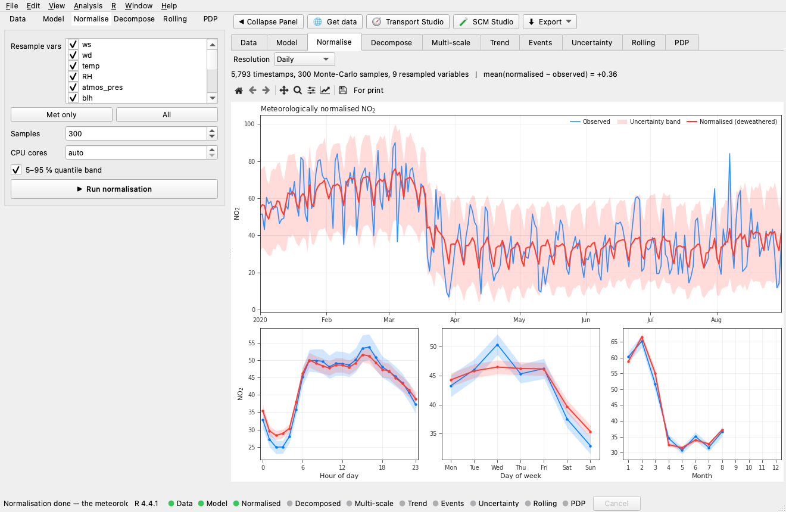

# normet: Meteorological Normalisation, Decomposition, and Counterfactual Modelling for Air Quality Time Series

**An R package for weather normalisation, decomposition, and synthetic-control policy evaluation on air-quality time-series**

<!-- badges: start -->
[](https://github.com/apai-sys/normet-r/actions/workflows/R-CMD-check.yaml)
[](https://github.com/apai-sys/normet-r/actions/workflows/build-gui.yml)
[](https://github.com/apai-sys/normet-r/blob/main/DESCRIPTION)
[](https://github.com/apai-sys/normet-r/blob/main/LICENSE.md)
[](https://github.com/apai-sys/normet-r/tree/main/docs)
<!-- badges: end -->

`normet` is an R package for **air-quality time-series analysis**. Pollutant
concentrations depend on the weather as well as on emissions, so a raw series
cannot show on its own whether an intervention or a trend is real. `normet`
trains a machine-learning model of the pollutant on weather and time, then uses
it to remove the weather-driven variation ("weather normalisation", or
"de-weathering"). It splits what remains into its drivers, puts error bars on
the result, and estimates causal effects with synthetic control methods — so
you spend time on science, not boilerplate.

`normet` brings together three ideas behind one API:

1. **Machine-learning model training** (LightGBM or H2O AutoML) learns how a
   pollutant concentration depends on meteorology, time, and other predictors.
2. **Monte Carlo meteorological normalisation ("de-weathering")** re-runs that
   model hundreds of times against resampled, randomised meteorology to cancel
   out day-to-day meteorological noise and reveal the underlying
   emission-driven trend.
3. **Synthetic Control Methods (SCM)** answer "what would have happened
   without this policy?" by building a counterfactual from untreated donor
   units, with placebo tests and uncertainty bands.

Data adapters for the UK networks, EEA, OpenAQ, ERA5, Open-Meteo and HYSPLIT
trajectories, an MCP server for AI assistants and a desktop app build on the
same API.



---

## Core capabilities

| Function | What it does |
|---|---|
| `nm_prepare_data` | Missing-value handling, date-feature engineering, train/test splitting |
| `nm_train_model` / `nm_build_model` | LightGBM with random hyperparameter search, or H2O AutoML |
| `nm_normalise` / `nm_normalise_ext` | Monte Carlo meteorological normalisation; quantile bands (`return_quantiles =`) and conditional resampling (`conditional_on =`, `_ext` only) |
| `nm_normalise_auto` | Auto-pilot normalisation: stops resampling when the series converges |
| `nm_decompose` | Split time series into emission-driven and met-driven components, by variable or group, sequential or Shapley |
| `nm_rolling` | Rolling-window normalisation for trend analysis |
| `nm_run_scm` | Synthetic Control Method with selectable backends: `scm` (default, ridge-augmented), `abadie` (classic simplex), `did`, `mcnnm` (nuclear-norm matrix completion), `robust` and `mlscm`; several treated units each with its own cutoff via `nm_run_scm_staggered` (per-unit effects and placebo p-values, plus the pooled mean and median, with the cross-unit permutation test on the mean) |
| `nm_mlscm` | ML-augmented SCM (**experimental** — see [Synthetic control](https://github.com/apai-sys/normet-r/blob/main/docs/guide/examples_scm_guide.md)) |
| `nm_placebo_in_space` / `nm_placebo_in_time` / `nm_rmspe_ratio_test` | Placebo significance tests and Abadie's RMSPE-ratio test |
| `nm_uncertainty_bands` | Bootstrap / jackknife confidence intervals |
| `nm_do_all` | End-to-end pipeline in one call |
| `nm_do_all_unc` | End-to-end pipeline with model-ensemble uncertainty bands |
| `nm_do_all_multisite` | Parallel per-site pipelines |
| `nm_pdp` / `nm_plot_pdp` / `nm_plot_pdp_grid` | Partial-dependence values and their plot grid |
| `nm_modStats` | Model performance metrics (R², RMSE, MAE, …) |
| `nm_trend` / `nm_trend_breaks` | Trend analyses with the block-bootstrap correction for autocorrelated records, plus the segmented (piecewise) trend for records whose level or slope changes part-way through |
| `nm_mann_kendall` / `nm_theil_sen` | Classical Mann-Kendall test and Theil-Sen slope with its analytic interval — uncorrected for autocorrelation; the block-bootstrap versions are in `nm_trend` |
| `nm_decompose_uncertainty` | Attribute a de-weathered estimate's total spread to its source — weather (met resampling) vs model form vs their interaction |
| `nm_detect_events` / `nm_anomaly_scores` | Event detection and anomaly scores on normalised residuals |
| `nm_plot_normalise` / `nm_plot_decomposition_stack` / `nm_plot_scm_dashboard` | Plotting helpers for normalisation, decomposition and SCM results |
| `nm_bayesian_scm` / `nm_plot_bayesian_scm` | Bayesian SCM with Dirichlet weights and credible bands |
| `nm_scm_diagnostics` / `nm_pre_trend_test` / `nm_plot_event_study` / `nm_loo_weight_stability` / `nm_conformal_effect_interval` | SCM fit diagnostics, the pre-period parallel-trends test and its event-study figure, donor-weight stability, conformal intervals |
| `nm_donor_spatial_summary` / `nm_spatial_summary` | Where the donor pool sits around the treated unit: per-donor distance, bearing and sector; the pool's centroid offset and sector coverage (a reading, not a fit input) |
| `nm_make_run` / `nm_save_run` / `nm_load_run` / `nm_generate_html` / `nm_report_to_markdown` | Provenance tracking and auto-generated HTML/Markdown run reports |
| `nm_make_cache` / `cache_dir` | On-disk caching for expensive pipelines |
| `nm_read_table` / `nm_read_time_series` | CSV/TSV, Excel, Parquet, Feather and JSON tables, with the times put on a site's clock |
| `nm_fetch_ukaq_measurements` / `nm_fetch_eea_data` / `nm_fetch_openaq_measurements` / `nm_fetch_era5_timeseries` / `nm_fetch_openmeteo_timeseries` | Data adapters for the UK air-quality networks, EEA, OpenAQ, ERA5 (Copernicus CDS) and Open-Meteo |
| `nm_build_trajectory_features` / `nm_join_trajectory_features` / `nm_fetch_gdas1` / `nm_run_back_trajectories` | HYSPLIT back-trajectory features, GDAS1 downloads and a full HYSPLIT run |
| `nm_mcp_server` / `nm_agent_tool` | Serve normet's tools to an AI assistant over MCP |

---

## Installation

Install the released version from CRAN:

```r
install.packages("normet")
```

The development version is on GitHub:

```r
# install.packages("remotes")
remotes::install_github("apai-sys/normet-r")
```

`normet` needs R ≥ 4.0 and at least one model backend. Both backends are
optional dependencies:

```r
install.packages("lightgbm")   # default backend (recommended)
install.packages("h2o")        # alternative: H2O AutoML (needs Java)
```

Other optional features come as ordinary `Suggests` packages, imported lazily
so `library(normet)` works without them:

| Package | For |
|---|---|
| `lightgbm` / `h2o` | The default backend, or the AutoML backend |
| `arrow` | Parquet and Feather tables |
| `readxl` | Excel tables |
| `ecmwfr` | ERA5 from the Copernicus CDS |
| `sf` | Polygon and shapefile source regions for the trajectory features |
| `memuse` | Memory estimates for large jobs |
| `patchwork` | The one-figure SCM dashboard |
| `forecast` | STL-residual event detection |
| `solitude` | Isolation-forest anomaly scores |

The [installation guide](https://github.com/apai-sys/normet-r/blob/main/docs/getting_started/installation.md)
lists every package and the credentials each data source needs.

**Desktop app.** The native Qt app lives in
[`gui/`](https://github.com/apai-sys/normet-r/tree/main/gui); from a clone,
`pip install ./gui`, then run `normet-r-gui`. Ready-made installers — `.dmg`
(macOS), `.exe` (Windows), `.AppImage` (Linux) — are built by the
[`build-gui.yml`](https://github.com/apai-sys/normet-r/blob/main/.github/workflows/build-gui.yml)
workflow (**Actions → Artifacts**). See
[Desktop GUI](https://github.com/apai-sys/normet-r/blob/main/docs/guide/gui.md).

---

## Quick start

`nm_do_all()` runs the full pipeline — prepare → train → normalise — in a
single call. The example uses `my1`: hourly NO2 and ERA5 meteorology at
London Marylebone Road (MY1), January–August 2020 — a window spanning the UK
COVID-19 lockdown.

```r
library(normet)

# Meteorological predictors + the time features the model will see
met_vars   <- c("ws", "wd", "temp", "RH", "atmos_pres", "blh", "tcc", "tp", "ssrd")
predictors <- c(met_vars, "date_unix", "day_julian", "weekday", "hour")

results <- nm_do_all(
  df            = my1,
  target        = "NO2",
  backend       = "lightgbm",     # or "h2o"
  covariates    = predictors,
  resample_vars = met_vars,       # resample met only — not the time features
  n_samples     = 300,
  n_cores       = 4                # H2O cluster allocation (lightgbm ignores it)
)

head(results$res)                # date | observed | normalised
nm_plot_normalise(results$res)
nm_modStats(results$df_prep, results$model)
```

`nm_do_all()` returns a list with `res` (the normalised table), `model` (the
trained model) and `df_prep` (the prepared frame). The
[step-by-step workflow](https://github.com/apai-sys/normet-r/blob/main/docs/guide/workflow.md) takes it apart and continues
into decomposition and synthetic control.

---

## Documentation

The user guide lives in
**[`docs/`](https://github.com/apai-sys/normet-r/tree/main/docs)**:

- **Getting started** —
  [installation](https://github.com/apai-sys/normet-r/blob/main/docs/getting_started/installation.md)
  and [quick start](https://github.com/apai-sys/normet-r/blob/main/docs/getting_started/quickstart.md),
  including the bundled example datasets.
- **User guide** — the
  [step-by-step workflow](https://github.com/apai-sys/normet-r/blob/main/docs/guide/workflow.md),
  then
  [weather normalisation](https://github.com/apai-sys/normet-r/blob/main/docs/guide/examples_normalisation.md),
  [feature engineering](https://github.com/apai-sys/normet-r/blob/main/docs/guide/examples_feature_engineering.md),
  [decomposition](https://github.com/apai-sys/normet-r/blob/main/docs/guide/examples_decomposition.md),
  [trend analysis](https://github.com/apai-sys/normet-r/blob/main/docs/guide/examples_trend.md),
  [uncertainty decomposition](https://github.com/apai-sys/normet-r/blob/main/docs/guide/examples_uncertainty.md),
  [synthetic control](https://github.com/apai-sys/normet-r/blob/main/docs/guide/examples_scm_guide.md),
  [Bayesian SCM](https://github.com/apai-sys/normet-r/blob/main/docs/guide/examples_scm.md),
  [multi-site pipelines](https://github.com/apai-sys/normet-r/blob/main/docs/guide/examples_multisite.md),
  [caching and provenance](https://github.com/apai-sys/normet-r/blob/main/docs/guide/examples_caching.md),
  [data adapters](https://github.com/apai-sys/normet-r/blob/main/docs/guide/examples_data_adapters.md),
  [a worked OpenAQ + ERA5 example](https://github.com/apai-sys/normet-r/blob/main/docs/guide/examples_openaq.md)
  and [plotting](https://github.com/apai-sys/normet-r/blob/main/docs/guide/examples_plotting.md).
- **Interfaces** — the
  [desktop GUI](https://github.com/apai-sys/normet-r/blob/main/docs/guide/gui.md)
  and the
  [MCP server for AI assistants](https://github.com/apai-sys/normet-r/blob/main/docs/guide/mcp.md).
- **R-native long-form articles** — `vignettes/articles/` (with the pkgdown
  navigation in `_pkgdown.yml`): data acquisition, the normalisation workflow,
  decomposition and uncertainty, causal inference, multi-site work and caching,
  backends, figures and reports, and the desktop GUI.
- **PDF user manuals** for the desktop app, in
  [English](https://github.com/apai-sys/normet-r/blob/main/gui/docs/manual/normet_manual.pdf)
  and
  [Chinese](https://github.com/apai-sys/normet-r/blob/main/gui/docs/manual/normet_manual_zh.pdf).

Every function has a help page (`?nm_normalise`, `?nm_run_scm`, ...). What
changed in each release is in
[NEWS.md](https://github.com/apai-sys/normet-r/blob/main/NEWS.md), and planned
work in the
[roadmap](https://github.com/apai-sys/normet-r/blob/main/docs/roadmap.md).

---

## How to cite

If you use `normet`, please cite it. `citation("normet")` gives the current
reference:

```bibtex
@Manual{normet,
  title = {{normet}: Meteorological Normalisation, Decomposition, and Counterfactual Modelling for Air Quality Time Series},
  author = {Congbo Song},
  year = {2026},
  note = {R package version 1.0.0},
  url = {https://github.com/apai-sys/normet-r},
}
```

A BibTeX entry is printed by `toBibtex(citation("normet"))`, and
[CITATION.cff](https://github.com/apai-sys/normet-r/blob/main/CITATION.cff)
has the same reference for GitHub's **Cite this repository** button.

---

## Contributing

Bug reports, feature requests and pull requests are welcome. Start with the
[contributing guide](https://github.com/apai-sys/normet-r/blob/main/CONTRIBUTING.md),
and report security problems privately as described in
[SECURITY.md](https://github.com/apai-sys/normet-r/blob/main/SECURITY.md).
Participation is governed by the
[Contributor Code of Conduct](https://github.com/apai-sys/normet-r/blob/main/CODE_OF_CONDUCT.md);
by contributing you agree to abide by its terms.

## License

GPL-3. See
[LICENSE.md](https://github.com/apai-sys/normet-r/blob/main/LICENSE.md).
