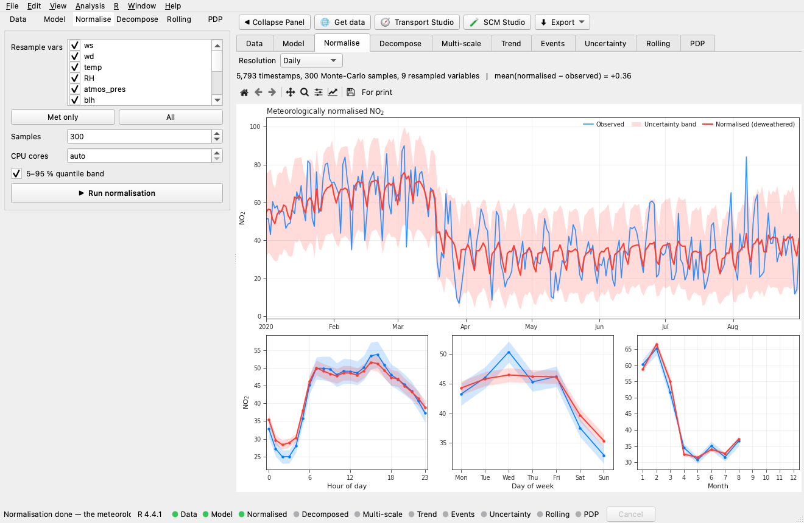
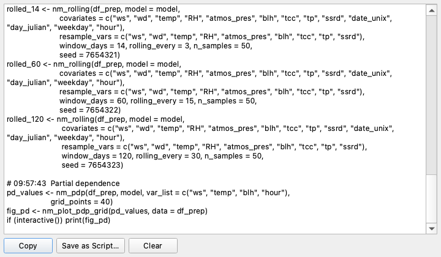
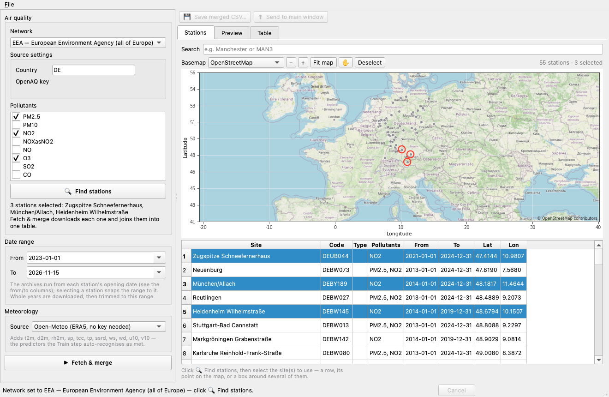
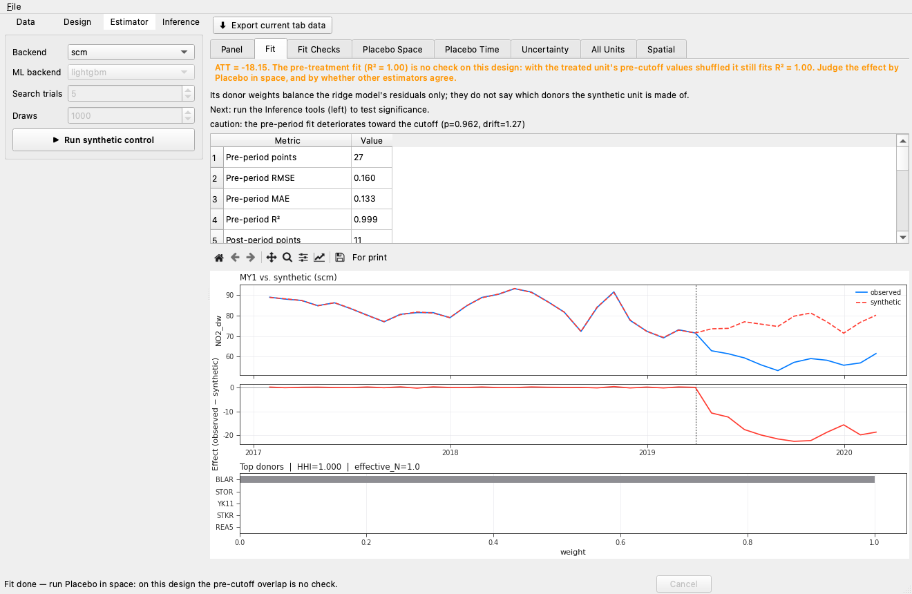
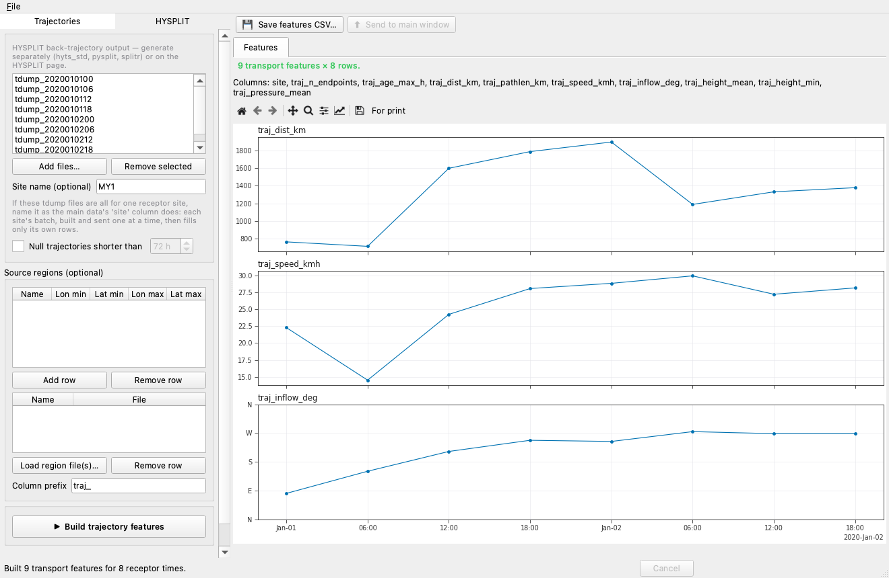

# Desktop GUI

A native Qt desktop app covers the full workflow without writing code, and runs
on macOS, Windows and Linux. The window is written in Python (PySide6) and
runs every analysis on this R package through `Rscript`.

**From a clone of this repository:**

```bash
pip install ./gui
normet-r-gui               # optionally: normet-r-gui mydata.csv
```

It needs `Rscript` on `PATH` and `normet` installed in that R. Ready-made
installers — `.dmg` (macOS), `.exe` (Windows, Inno Setup), `.AppImage`
(Linux) — are built by the
[`build-gui.yml`](https://github.com/apai-sys/normet-r/actions/workflows/build-gui.yml)
workflow's 3-OS matrix; grab the latest from the workflow's
**Actions → Artifacts**.

The step-by-step manual with a screenshot of every panel is available as a PDF
in [English](https://github.com/apai-sys/normet-r/blob/main/gui/docs/manual/normet_manual.pdf)
and [Chinese](https://github.com/apai-sys/normet-r/blob/main/gui/docs/manual/normet_manual_zh.pdf).

## Main window



The meteorological-normalisation workflow as numbered steps in a left-hand
panel — Data → Model → Normalise → Decompose → Multi-scale → Trend → Events →
Uncertainty → Rolling → PDP — with results in tabs that activate as each step
finishes. The result tabs and the status-bar step lights follow that order:
the Decompose-page questions (Multi-scale, Trend, Events, Uncertainty) sit
directly after Decompose, then the separate steps Rolling and PDP. Every
result is summarised by a traffic-light verdict banner.

- **Model.** Choose the backend — `lightgbm` (random hyperparameter search
  within its trial budget) or `h2o` (an AutoML search bounded by the
  **Search models** count — 5 by default — under a 600 s safety cap).
- **Normalise.** Choose exactly which variables are resampled in the
  Monte-Carlo ("Met only" by default).
- **Decompose.** The emission or meteorological decomposition, by variable or
  by named group, with sequential or Shapley attribution.
- **Multi-scale.** Differences rolling-deweathered series at increasing window
  widths (14/90/365 days by default) against each other and against the
  full-record baseline, isolating the meteorological residual specific to each
  timescale band; an energy-by-band ranking names the dominant timescale.
- **Trend, Events, Uncertainty.** The trend test and its segmented form, event
  detection on normalised residuals, and the spread's attribution to weather
  versus model form.
- **Rolling and PDP.** Rolling-window normalisation, and partial-dependence
  profiles with one-click "Time variables"/"Met only" toggles for the variable
  list.

Includes drag-and-drop CSV loading, recent files, config save/load, run
history, CSV/HTML export, a live log dock, and one-click synthetic example
data. The window and its figures follow the system's light/dark appearance (or
View → Appearance), Ctrl+K (⌘K) finds any menu command or result tab by
typing, and before a table is open the Data tab offers the examples and recent
tables. Long computations run on a background thread; the window stays
responsive and tasks can be abandoned from the status bar.

## Assistant

**View → Assistant, Ctrl+Shift+A** — a language model working in the window.
It reads what the window holds (the table, the model's fit on the held-out
rows, the normalised series, the decomposition) and runs its steps as their
buttons do, through the same R process the panels use. It *proposes* a target
and predictors as a card with an **Apply** button: nothing in the panel changes
until you click it, and it trains or normalises only once you have agreed.

Choose an API model as `provider:model` (`anthropic:claude-sonnet-5-5`,
`deepseek:deepseek-chat`, `lmstudio:local-model`, …), its key kept in the
macOS keychain (**Key…**) or read from the provider's environment variable. A
server of your own is named in one dialog, **Add a server…** on the model list
(or by typing `name:model` and giving its address under **Key…**). Or choose a
command-line agent signed in to your own plan — Claude Code, Codex, Antigravity
agy or GitHub Copilot — with the effort it thinks at: the window serves its
tools to the agent over MCP on 127.0.0.1 with a per-window token, and gives it
no shell or files of its own.

## Command Log and figures for print



**View → Command Log** — every step you run, written as the R call that
repeats it — `nm_do_all(...)`, `nm_decompose(...)`, `nm_run_scm(...)` — with
the arguments it actually ran with. File → Save Session as Script… turns a
session done by clicking into an R script that reproduces it.

**For print…** on any figure's toolbar lays the figure out at a journal's
column width (Nature, Elsevier, ACS, or custom) with its lettering in points,
shows it at its printed size to finish — drag or place the legend and set its
columns, set line widths and markers, letter the panels, double-click any text
or tick numbers to edit them — and saves it at that exact width on a white
page, leaving the figure on its tab as it was.

## Data Studio



**🌐 toolbar button, or File → Get Data** — assemble a model-ready dataset
without leaving the app: pick a network — the six UK networks (AURN, AQE,
SAQN, WAQN, NI, LMAM), the EEA reporting network for Europe (country code, no
key), or OpenAQ for most of the world (free API key) — then find its stations
by the pollutants they measure and pick one, or several, by name, by official
site code (e.g. "MAN3" for Manchester Piccadilly) or on the map: a click, a
box drawn around them, or ⌘/Ctrl-click to add. The map sits on OpenStreetMap
or Esri tiles, zooms and pans. Choose a date range and fetch the hourly
measurements together with ERA5-derived meteorology from Open-Meteo (no API
key; Copernicus CDS optional); several stations become one panel-shaped table
with a site column. The merged table can be saved as CSV or sent straight into
the Model step.

## SCM Studio



**Analysis → Synthetic Control, or the 🧪 toolbar button** — the
counterfactual workflow on panel data: map date/unit/outcome columns, pick the
treated unit, cutoff and donor pool, choose an estimator (`scm`, `mlscm`,
`abadie`, `did`, `mcnnm`, `robust`, `bayesian`), then run fit + diagnostics,
placebo-in-space/time, jackknife/bootstrap uncertainty bands and the all-units
batch — each with a p-value / fit-quality verdict. The donor-spatial summary
places the pool around the treated unit (distance, bearing, compass sector,
centroid offset and sector coverage) beside the fit.

## Transport Studio



**🧭 toolbar button** — build transport-aware predictors from HYSPLIT
back-trajectories: parse existing `tdump` files (no external binary needed)
into per-receptor features (inflow direction, transport distance/speed,
residence time over named source regions, along-path rainfall/boundary-layer
height), preview them, then join them onto the loaded dataset — each row takes
the latest trajectory to have arrived, within one release interval, and each
site its own — with the new `traj_*` columns auto-ticked as predictors in the
Model step. An advanced panel can also drive `hyts_std` itself for a set of
receptor times, with GDAS1 meteorology it downloads or met files already on
disk, if HYSPLIT is installed locally.
