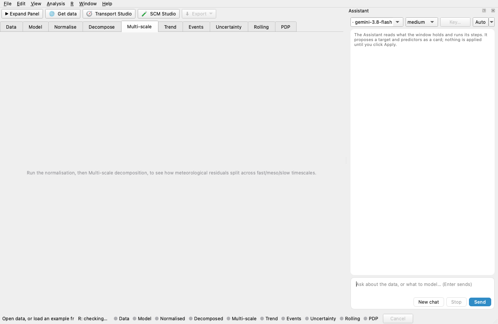

A native Qt desktop app (`gui/` in the repository, Python + PySide6) covers the
full workflow without writing R code. Every computation is delegated to the
normet R package through `Rscript` subprocesses, so the app needs R, with
normet installed, on the machine that runs it. It runs on macOS, Windows and
Linux.



The window is shared with the Python package
[normet-py](https://github.com/apai-sys/normet-py), from which it is vendored.
The analyses it runs are this package's R functions.

## Install

**From source** (needs Python 3.10+), from the repository root:

```bash
pip install ./gui
normet-gui                # optionally: normet-gui mydata.csv
```

**Or download a ready-made installer:** `.dmg` (macOS), `.exe` (Windows, Inno
Setup) or `.AppImage` (Linux). These are built by the
[`build-gui.yml`](https://github.com/apai-sys/normet-r/blob/main/.github/workflows/build-gui.yml)
workflow on all three operating systems. Download the latest from that
workflow's **Actions → Artifacts**. You can also build one locally, with
`gui/packaging/macos/build_dmg.sh` (macOS) or
`pyinstaller gui/packaging/normet_r_gui.spec` (any OS). See
[`gui/packaging/README.md`](https://github.com/apai-sys/normet-r/blob/main/gui/packaging/README.md).
R itself is never bundled, only the bridge script. If R is not on `PATH`, use
**R → Locate Rscript…** in the app.

## The user manual

The illustrated user manual walks through every step with the window's own
screenshots. It is available in
[English](https://github.com/apai-sys/normet-r/blob/main/gui/docs/manual/normet_manual.pdf)
and [Chinese](https://github.com/apai-sys/normet-r/blob/main/gui/docs/manual/normet_manual_zh.pdf).

## Main window

The main window follows the same numbered steps as the R workflow (Data →
Columns → Train → Normalise → Decompose → Rolling → PDP). Results appear in
tabs that become active as each step finishes.

- The result tabs and the status-bar step lights follow the workflow's order:
  Data, Model, Normalise, Decompose, then the questions the decomposition
  invites (Multi-scale, Trend, Events, Uncertainty), then the separate steps
  Rolling and PDP.
- A traffic-light verdict banner summarises the model's quality.
- When the H2O backend is selected, the Train step shows the H2O AutoML
  algorithm picker (GBM/DRF/GLM/DeepLearning/StackedEnsemble/XGBoost). The H2O
  cluster is started once per GUI session and shut down on exit.
- The **Multi-scale decomposition** panel differences rolling-deweathered
  series at increasing window widths against Step 4's full-record baseline.
  This isolates the meteorological residual specific to each timescale. An
  energy-by-band ranking (σ) names the dominant timescale at a glance, and
  each band is drawn in its own cascade colour.

Long computations run in the background. The window stays responsive, and tasks
can be abandoned from the status bar.

## Data Studio

The **Data Studio** (🌐 toolbar button) assembles a model-ready dataset without
leaving the app.

1. Pick a network: one of the six UK networks (AURN, AQE, SAQN, WAQN, NI,
   LMAM), the EEA reporting network for Europe (a country code, no key), or
   OpenAQ for most of the world (a free API key).
2. Find its stations by the pollutants they measure. Pick one or several by
   name, by official site code (e.g. "MY1" for London Marylebone Road), or on
   the map. On the map, click a station, draw a box around several, or
   ⌘/Ctrl-click to add one. The map sits on OpenStreetMap or Esri tiles, and
   it zooms and pans.
3. Choose a date range and fetch the hourly measurements together with
   ERA5-derived meteorology from Open-Meteo (no API key; the Copernicus CDS is
   optional).

Several stations become one panel-shaped table with a `site` column. The
merged table can be saved as CSV or sent straight into Step 1.

## SCM Studio

The **SCM Studio** (🧪 toolbar button) runs the counterfactual workflow on
panel data:

1. Map the date, unit and outcome columns.
2. Pick the treated unit, the cutoff and the donor pool.
3. Choose an estimator (`scm`, `mlscm`, `abadie`, `did`, `mcnnm`, `robust`).
4. Run the fit and diagnostics, placebo-in-space and placebo-in-time,
   jackknife or bootstrap uncertainty bands, and the all-units batch.

Each run comes with a p-value or fit-quality verdict.

## Transport Studio

The **Transport Studio** (🧭 toolbar button) builds transport-aware predictors
from HYSPLIT back-trajectories.

- It parses existing `tdump` files into per-receptor features: inflow
  direction, transport distance and speed, residence time over named source
  regions, and rainfall and boundary-layer height along the path.
- You can preview the features, then join them straight onto the loaded
  dataset by nearest hour. The new `traj_*` columns are ticked as predictors
  in Step 1 automatically.
- If HYSPLIT is installed locally, an advanced panel can also drive
  `hyts_std` itself, downloading the matching GDAS1 meteorology first.
